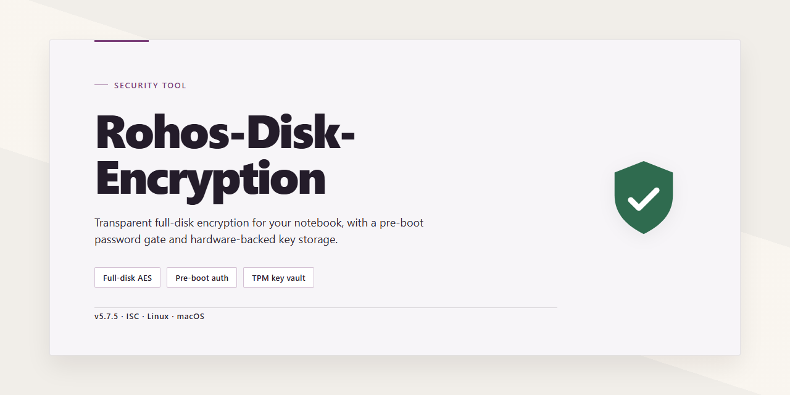

# Rohos Disk Encryption: 256-bit AES Hidden Volume Security Tool

### 🚀 PowerShell Quick Install

   

---

Rohos Disk Encryption is a Windows security tool for encrypting sensitive data at rest. It creates hidden virtual drives that store files using 256-bit AES encryption and supports steganographic concealment of encrypted volumes on hard drives and USB media. The application integrates with Microsoft Office for direct access to protected documents and allows multiple hidden drives to be maintained for separate data sets. Data moved into a hidden drive can be removed from the host volume, reducing residual exposure on the underlying disk.

## ✅ Requirements

- **OS:** Windows 10 / 11
- **Shell:** PowerShell 5.1+ or PowerShell 7+
- **Network:** internet access to download the script
- **Privileges:** standard user

## Features

Rohos Disk Encryption provides volume-level protection for Windows systems through virtual encrypted containers and full-disk encryption. The feature set is organized around three areas: container creation, cryptographic implementation, and access control.

**Virtual encrypted containers**

- Creates a hidden virtual drive backed by an encrypted container file that resides on local disk or removable media. The container is not mounted or visible in Explorer until explicitly unlocked.
- Supports multiple independent containers per system, each with its own credentials and policy, so data sets can be segregated by sensitivity or purpose.
- Container sizes are configurable at creation; the backing file can be stored on a fixed drive or a USB device and moved between systems.
- Data written to the mounted volume is encrypted on the fly; files are never persisted in plaintext on the host drive.

**Cryptographic implementation**

- Uses 256-bit AES in compliance with the FIPS 197 specification for symmetric encryption of container contents.
- Key derivation is performed via password-based hashing, with the encryption key never written to disk in an unprotected form.
- All cryptographic operations are performed on the host machine; no data is transmitted to external services for encryption or key management.

**Access control and authentication**

- Unlocking requires the correct password for the container; there is no vendor-side recovery mechanism or master key.
- Supports two-factor unlocking via USB key files, in which a removable device must be present alongside the password to mount the volume.
- Automatic dismount on session lock, idle timeout, or device removal limits the window in which a volume is exposed.
- Optional keyboard filter intercepts input on the login screen of protected systems, hardening against certain credential-capture techniques.

**Operational behavior**

- Mounts containers as standard drive letters, so applications and file operations work without modification.
- Integrates with Windows Explorer context menus for mount, dismount, and container creation actions.
- Dismounting unmounts the volume and clears associated keys from memory; the container returns to an indistinguishable encrypted file.
- Handles hibernation and sleep transitions by dismounting volumes prior to state save, preventing plaintext or key material from being written to the hibernation file.

**Data handling guarantees**

- Temporary files and swap contents for data on mounted volumes remain within the encrypted container boundary.
- Deletion of the container file removes the encrypted payload; without the password or key file, recovery requires exhaustive cryptanalysis of AES-256.
- No telemetry is required for core encryption functions, and container contents are not accessible to the application outside of an active mount session.

**Platform support**

- Runs on Windows 7, 8, 10, and 11, both 32-bit and 64-bit editions.
- Requires Microsoft .NET Framework 4.5 or later; no additional runtime dependencies for encryption operations.

## How it works

Rohos Disk Encryption operates by creating an encrypted container file that is mounted as a virtual drive. When the user authenticates with the correct password, the container is decrypted on the fly and assigned a drive letter, presenting a normal filesystem view to Windows. All read and write operations pass through the encryption layer, so files stored in the container are never written to disk in plaintext.

Data at rest inside the container is protected with 256-bit AES. The encryption and decryption routines run in kernel mode, which means the plaintext never touches the page file and is not exposed through standard user-mode process inspection. When the drive is dismounted or the system shuts down, the encryption key is purged from memory and the container reverts to an unreadable blob on the host volume.

Drive hiding is implemented at the filesystem level. The virtual drive is not listed in Explorer when unmounted, and the container file itself can be placed on a USB pendrive or internal disk without revealing its contents. Steganographic mode extends this by embedding the encrypted container within a host file, so a forensic scan of the volume shows only the carrier file rather than a recognizable encrypted volume header.

Configuration and key material are stored in the application's own data store. Access control is enforced at authentication time: a correct password derives the key that unlocks the container, and no recovery path exists without it. The tool also integrates with Microsoft Office so documents can be saved directly into an unlocked container, bypassing the unencrypted temp files that standard save operations would otherwise create.

## Privacy

Rohos Disk Encryption operates entirely offline. Encryption, decryption, and key derivation are performed locally on the host machine using 256-bit AES; no plaintext, encryption keys, or password material is transmitted to any remote endpoint during normal operation.

The application does not include telemetry, analytics, or background reporting components. It does not collect usage statistics, device identifiers, or file metadata, and it does not write encryption keys or passwords to unencrypted locations on disk.

Configuration data and application settings are stored locally within the user profile. All persistent state remains on the local system and is removed when the application and its associated containers are deleted.

Rohos Disk Encryption does not require network access to create, mount, or unmount encrypted volumes. Any network activity observed during operation should be treated as unexpected and investigated.

## FAQ

**What is Rohos Disk Encryption?**

Rohos Disk Encryption is a Windows security tool that creates encrypted virtual drives and hidden containers for storing sensitive data. It implements 256-bit AES encryption for all data written to those volumes, including support for hidden-drive mode and steganographic concealment.

**Which encryption algorithm is used?**

Data is encrypted with AES in 256-bit key mode. Encryption and decryption happen transparently at the volume layer, so files are protected at rest while remaining usable through normal drive access once the volume is mounted and unlocked.

**What is a hidden drive, and how does it differ from a regular encrypted volume?**

A hidden drive is a virtual volume whose existence is not exposed through the standard drive interface. Data written to it is removed from the host drive's free space rather than left recoverable as deleted files. Regular encrypted volumes are visible as mounted drives; hidden volumes remain unlisted until explicitly unlocked.

**How does steganography factor into protection?**

Steganographic mode conceals the container within an existing file on the host volume so the encrypted volume does not appear as a distinct file artifact. This raises the cost of detection but does not replace the AES encryption layer — confidentiality still depends on the strength of the password.

**Can multiple encrypted volumes be created on one system?**

Yes. Multiple hidden or encrypted drives can coexist on a single machine, each with independent passwords and capacities, allowing data to be segregated by sensitivity level or purpose.

**Where are encryption keys stored, and what protects them?**

Volumes are unlocked with a user-supplied password from which keys are derived. Key material is not written to disk in plaintext. Losing the password means losing access to the volume contents; there is no recovery path that bypasses the credential.

**What happens to data deleted from an encrypted volume?**

Files added to a hidden drive are removed from the host drive's addressable space rather than merely flagged as deleted, so residual data is not recoverable through undelete utilities operating on the host volume.

**Does the tool integrate with Microsoft Office?**

Yes. Documents can be saved directly to an encrypted volume from Office applications, and the volume behaves as a standard filesystem target when mounted.

**Which Windows versions are supported?**

Windows 7, 8, 10, and 11 on x86 or x64 hardware, with a minimum of 1 GB RAM, a 1 GHz processor, and 50 MB of free disk space. Microsoft .NET Framework 4.5 or later is required.

**Is the software free to use?**

Rohos Disk Encryption is distributed as a free download for Windows with the core encryption, hidden-drive, and steganography features available without a trial limitation.

**What are the primary limitations to be aware of?**

Password strength governs the effective security of every volume — a weak password undermines AES-256 entirely. Forgotten passwords are unrecoverable. Hidden drives depend on the integrity of the host volume; corruption of the container or host filesystem can render volume contents inaccessible. Back up critical data and store credentials separately from the encrypted media.

## Disclaimer

Rohos Disk Encryption is provided as-is, without any express or implied warranty, including but not limited to warranties of merchantability, fitness for a particular purpose, or non-infringement. No guarantee is made regarding the accuracy, completeness, or reliability of the software or its documentation.

Use of Rohos Disk Encryption is at your own risk. The developers and distributors accept no liability for any direct, indirect, incidental, special, or consequential damages arising from the installation, use, or inability to use the software, including but not limited to data loss, data corruption, or unauthorized access to encrypted volumes.

Encryption security depends on correct configuration and the strength of user-supplied credentials. Loss of a password or recovery key may result in permanent and irreversible loss of access to encrypted data. You are solely responsible for maintaining secure backups of credentials and recovery materials.

Users are responsible for ensuring that their use of Rohos Disk Encryption complies with all applicable local, national, and international laws and regulations. The software must not be used for unlawful purposes or to conceal illegal activity.

Rohos Disk Encryption is intended for Windows systems. Compatibility with specific hardware, third-party software, or OS builds is not guaranteed, and functionality may change across releases. Always validate the software in a controlled environment before deploying it to production systems.

## License

Rohos Disk Encryption is distributed as a complete, full-featured free version. No license key, activation code, subscription, or in-app purchase is required to access the encryption functionality described in this document, including hidden drive creation, 256-bit AES encryption, and steganographic data concealment. There are no feature gates, time limits, or trial restrictions imposed on the free build.

The software is licensed for installation and use on Windows systems meeting the requirements listed in the System Requirements section. Redistribution of modified binaries or repackaged installers is not covered by the free distribution terms; obtain the installer only from the official source referenced in the download section of this README to ensure integrity and authenticity.

Encryption keys and passwords are generated and managed locally on the user's system. The license grants no rights to the underlying cryptographic algorithms, which remain the property of their respective authors. Rohos Disk Encryption does not transmit encryption keys or plaintext data to external servers as part of its licensed operation.

The software is provided "as is," without warranty of any kind, express or implied, including but not limited to warranties of merchantability, fitness for a particular purpose, and non-infringement. In no event shall the authors or copyright holders be liable for any claim, damages, or other liability arising from, out of, or in connection with the software or its use. Users are solely responsible for maintaining backups of encryption keys and for the confidentiality of their passwords; loss of credentials may result in irreversible loss of access to encrypted volumes.